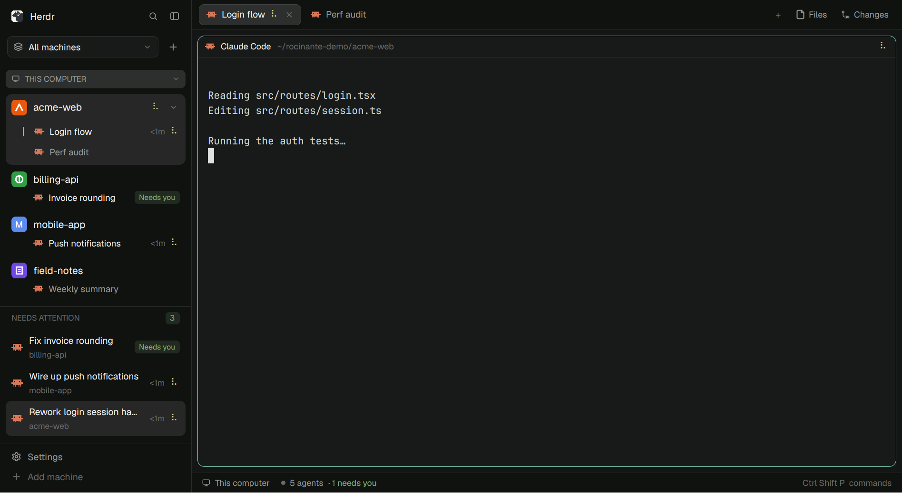

# Rocinante

A layout for the [Herdr app](https://herdr.dev): one sidebar for every machine,
space and agent, a hit list of agents that need you, and a terminal menu that
opens what your terminals mention in the file manager.



- **One sidebar.** Spaces grouped under each machine, with a picker for all
  machines or one. Each space shows its project's own icon when it has one
  (favicon, app icon, browser-extension icon, inline SVG favicon), otherwise a
  colored letter tile. A space with one agent shows that agent's work on a
  second line; a space with more opens into its tabs and agents.
- **Machines.** Click a machine header to collapse it to the bottom of the
  sidebar; drag headers to reorder. Connected machines are neutral; connecting
  is yellow, unreachable is red.
- **Needs attention.** Only agents that are working, waiting on you, or
  finished while you weren't looking. Empty means you're caught up.
  `agent.next` walks this list.
- **Open paths.** Right-click a terminal: "Open in file manager" lists the
  file and folder paths written in it, newest first (paths the terminal
  wrapped are rejoined). Click one to open it.
- **One spinner.** Every working agent shows the same braille spinner.

## Install

Tell your agent:

> Read ~/.config/herdr-app/AGENTS.md, then add this layout:
> https://github.com/gig3m/herdr-rocinante

Or by hand: copy `layouts/rocinante.json` to `~/.config/herdr-app/layouts/`,
each folder in `mods/` to `~/.config/herdr-app/mods/`, merge `keys.json` into
yours, then switch layouts (`ctrl+shift+l`, or Settings → Look). Your own
layout stays as it was.

## Keys

Bound only while Rocinante is shown (`layout:rocinante` in `keys.json`):

| Key | Does |
|---|---|
| `ctrl+shift+a` | Next agent (the Needs attention list first) |

## Project icons

The sidebar looks in the git repo root of where a space's first terminal is now
(on that space's machine; a folder that isn't in a repo keeps its letter tile) for, in order: app and
touch icons, `icon*.png|svg`, SVG favicons and logos, an SVG favicon written
into an HTML page, larger PNG favicons, then `favicon.ico`. Build output, tests
and examples rank lower; files over 90 KB are skipped.

For a project whose icon can't be found (a logo drawn by CSS, say), put a file
in `~/.config/herdr-app/project-icons/` (it survives updates to the mod;
the mod's own `project-icons/` folder is read too) named
`<machine>--<repo folder name>.svg` (or `.png`), where `<machine>` is the
name from `hc machine ls`, or `local` for this computer. It wins over anything
found.

Found icons are cached in `mods/rocinante-sidebar/.icons/`; each project is
looked up once and again every 30 minutes, and cached icons nothing has
refreshed for 7 days are deleted.

## Omarchy (optional)

`omarchy/` makes Herdr follow your [Omarchy](https://omarchy.org) theme:

```sh
mkdir -p ~/.config/omarchy/themed
cp omarchy/herdr-app.json.tpl ~/.config/omarchy/themed/
omarchy hook install theme-set omarchy/herdr-app-theme
omarchy theme set "$(omarchy theme current)"   # apply once now (also moves to the next wallpaper)
```

Don't pick a theme in Herdr's Settings → Look afterwards: a pick there sticks
to the layout and overrides Omarchy's.

## What it costs

- The terminal menu reads that terminal (`hc read`) once, when it opens.
- The sidebar runs one `find` per project folder (again after 30 minutes or
  when a space moves) to look for its icon.
- Spinners are native animations, not redraw timers.

## Platforms

Built and used on Linux (Omarchy). Opening paths uses
`org.freedesktop.FileManager1` over D-Bus, falling back to `xdg-open`; on
macOS it uses Finder (`open`, `open -R`), which is untested. Windows is
untested. Project icons on a remote machine need GNU `find` and `base64`
(any Linux box); a remote Mac shows letter tiles. Paths in terminals on other machines aren't opened (they'd need a
network file browser).

## Herdr version

Made for Herdr 0.1.10. `mods/rocinante-tabs` and `mods/rocinante-pane` are
modified copies of Herdr's own `tabs` and `pane` mods (see NOTICE), so they
won't pick up Herdr's later fixes to those until they're refreshed.

## License

Apache License 2.0. See LICENSE and NOTICE.
