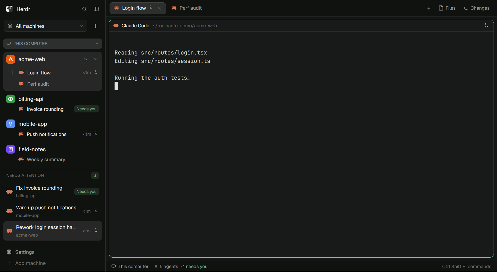

# Rocinante

A Herdr layout that folds spaces and agents into one sidebar grouped by
machine, adds a "needs attention" list under it, and a terminal right-click
menu that lists the paths written in that terminal and opens them in the file
manager. Everything follows the theme; working agents show one
braille spinner everywhere.

## What you see

Left to right:

1. **Sidebar** (268 px, resizable 44–480; narrower than 160 px it becomes a rail).
   Top to bottom:
   - Herdr's brand bar (`workspace-chrome`, 46 px).
   - **Machine picker** (40 px): a bordered button (`surface` fill, `border`,
     radius 7) reading "All machines" / "This computer" / a machine name with a
     layers / monitor / server icon and a chevron; a `+` beside it starts a
     space on the picked machine.
   - **Spaces list** (weight 2): with All machines, a header band per machine
     (26 px, radius 7, caps 11 px semibold, server or monitor icon, chevron),
     neutral `muted` text on `raised` when connected, `#e3b341` (connecting)
     or `#e5534b` (unreachable) text on that color at ~12 % alpha. Collapsed
     machines sit docked at the bottom of the list in the order they were
     collapsed, showing their space count and most urgent status.
     Under each machine its spaces: a 22 px tile (project icon, else the
     space's color with its initial in white bold) and the name in 14 px bold.
     A space with one agent has a second line: the agent's program icon, its
     name, working time (`<1m`, `4m`, `2h`) and status. A space with more
     agents or tabs has a chevron; open, its tabs follow (28 px, indented 39),
     and a tab with several agents lists them (26 px, indented 61). The
     selected open space and its rows share one `selected` card (radius 9);
     the row in view inside it gets a 2 px `accent` bar at its left instead of
     a fill. A collapsed selected space gets `selected` on its own row.
   - **Needs attention** (weight 1): caps header with a count badge (blocked
     tint when something waits on you), then rows: program icon, agent's work
     in 13 px, "machine · space" in 11.5 px `dim`, time, status. Empty: a
     check icon and "All caught up".
   - Herdr's footer (Settings, Add machine).
2. **Work column**: Herdr's tab bar, the active tab's panes as cards with a
   header (Herdr's pane header), and the status bar. Herdr's Files and
   Changes panel on the right is unchanged.

## How it behaves

- Status marks everywhere: working = braille spinner `⠋⠙⠹⠸⠼⠴⠦⠧⠇⠏` at 80 ms
  in `working`; blocked = "Needs you" pill (`blocked` on its 15 % tint);
  done = 7 px `done` dot; idle = nothing.
- Click a space: select it. Right-click: Herdr's space menu. Chevron: open or
  close it (remembered per space; the selected space starts open).
- Click an agent or tab row: focus it. Agent rows show the tab's name when the
  tab is named, else the agent's terminal title (leading glyphs stripped);
  right-click the name to switch between the two (remembered per tab).
- Drag a space's row onto another space or open card in the same machine: `space.move` to that position (in `spaces()`, from 1), with an accent line showing where it lands and the source dimmed.
- Machine header: click collapses (it moves to the bottom; the newest collapse
  goes last) or reopens it; drag it onto another open header to reorder, with
  an accent line showing where it lands. Order and collapses are remembered.
- Needs attention lists blocked, then done, then working agents (newest
  first within each) and sets `setAgentOrder`, so `agent.next` walks it.
  Idle agents never appear; a done agent leaves once looked at.
- Terminal right-click: "Open in file manager" with up to 8 paths from the
  terminal, then Herdr's pane items (split right/down, zoom, right-click
  routing, send back to parent, close).

## Built from

- Layout `rocinante`: Herdr's `main` with `sidebar-lists` replaced by a column
  of two blocks, `rocinante-sidebar` (weight 2, min 120) and
  `rocinante-attention` (weight 1, min 90); the tab bar block uses
  `rocinante-tabs`; the pane header uses `rocinante-pane`; root
  `"terminal_menu": "rocinante-paths"`.
- `rocinante-sidebar`: `spaces()`, `agents()`, `machines()`, `panes()`,
  `shared("space.colors")` (same colors as Herdr's spaces list), shared
  `"rocinante.machine"` for the picker, `localStorage` for open spaces,
  machine order and collapses, name switches and the icon cache. Commands:
  `space.select`, `space.new`, `tab.select`, `pane.focus`. The machine menu is
  the same mod opened as a popup with `props.machineMenu`. Icons: one `exec`
  of `sh -c` (git top level, `find`, a `grep` for `data:image/svg+xml` in
  HTML) on the space's machine; remote files come back via `base64`.
- `rocinante-attention`: `agents()`, `spaces()`, `setAgentOrder`,
  `agent.focus`.
- `rocinante-paths`: the terminal menu (`props().target` = `{pane, terminal}`).
  Reads the terminal once with `hc(["read", addr, "--lines", "300"])`.
  `paths.js`: path regex (must start a word), wrap rejoin, a single
  `sh -c 'for p do [ -d … ] …'` existence check, `gdbus call`.
- `rocinante-tabs`, `rocinante-pane`: Herdr 0.1.10's `tabs` and `pane` with a
  braille spinner instead of the ring.
- Icons from Herdr's `mods/workspace-chrome/`.

## Watch out

- Write `mod.json` (with `"place": "none"`) before `main.js` in a new mod
  folder, or Herdr docks the mod on the right the moment it sees the folder.
- `herdr-app check` renders with no spaces or agents, so it misses bugs that
  need live data; e.g. `.child(null)` throws "child value expects an element".
  Status helpers must return an element (an empty `div()`), never null.
- A mod can't import another mod's files ("resolves outside the application
  directory"), so shared code lives inside the one mod that uses it.
- Don't poll a terminal with `hc read` while it's on screen: in herdr-app
  0.1.10 a side panel that read the focused terminal every 2 s left that
  terminal unrepainted after the panel closed (it caught up seconds later).
  Read once, on demand.
- In a JS template literal a shell `\(` loses its backslash; the `find`
  script is a `String.raw` template.
- Writing files into a mod's folder reloads it, except hidden ones: the icon
  cache is `.icons/`.
- Collapsed machines live outside the scrolling list (`flex_none` at the
  bottom).
- Limits: 8 paths in the menu, 300 history lines read; icon
  files over 90 KB skipped (they pass through a command line as base64).

## Done when

- The sidebar shows "THIS COMPUTER" and every machine from `hc machine ls`,
  each space under its own machine, and picking one machine hides the others.
- A project with `public/favicon.svg` or `extension/icon128.png` shows it as
  its tile within a few seconds; one without keeps its letter tile.
- Clicking a machine header moves it to the bottom; clicking again restores it.
- A working agent shows the braille spinner in the sidebar, the attention
  list, the tab bar and its pane header.
- With no working, blocked or done agents, Needs attention reads
  "All caught up".
- After `echo /etc/hostname` in a local terminal, right-clicking it lists
  `/etc/hostname`, and clicking that opens the file manager on `/etc` with
  `hostname` selected.
- `herdr-app check` passes for all five mods and `herdr-app status` reports no
  errors.
